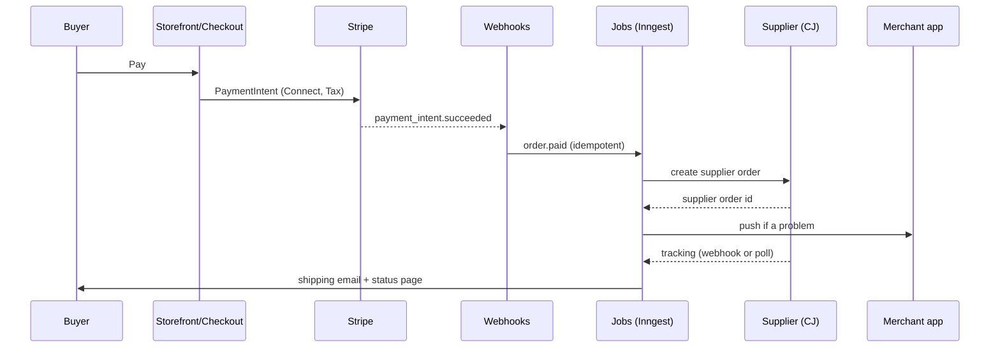

# Build plan: a store platform that beats Shopify, on the web and in the app

Version 2, 2026-10-08. Built with the Replica pack (recon, entrepreneur, architect, design, backend, test, launch and deploy playbooks). Sources in this folder: `recon.md`, `features.csv`, `reviews.csv`, `fixes.md`. Database: `schema.sql`.

Working name in this plan: **the platform**. A real name comes in the brand step, after trademark checks.

---

## 1. The product in one page

**What it is.** A store platform for dropshippers and small online sellers. It covers a web admin, fast storefronts, checkout, built-in supplier fulfilment, and an iOS and Android app that can run the whole store. AI agents do the routine work, and the merchant approves anything that matters.

**Who it is for first.** Solo dropshippers and small sellers with 0 to 500 orders a month. Today they pay for a Shopify plan plus 5 to 10 apps, and they can't reach a person when money or their store is at risk.

**The promise.** Everything you need to sell is built in, for one price. When something goes wrong, you see why and you can fix it, from your laptop or your phone.

**Product principles** (each one traces to a complaint in `fixes.md`):

1. **Built in, not bolted on.** Supplier import, fulfilment, reviews, upsells and email are part of the platform. No app tax.
2. **Never in the dark.** Every hold, pause, failed order or rejected payout comes with a reason, a next step and a date.
3. **Agents do, people decide.** AI agents propose and carry out work. Anything that moves money, changes live prices or messages customers in bulk waits for approval.
4. **Yours to take.** Standard web themes, a full export in one click, and an open API.
5. **Phone-first operations.** Anything that needs attention can be finished in the app.
6. **Fast by default.** Storefront pages load fast on a mid-range phone on 4G, because there are no third-party app scripts.

**Success measures for the first version:**

| measure | target |
| --- | --- |
| time from sign-up to a store live with a real product | under 15 minutes |
| clicks to import a supplier product and publish it | 3 or fewer |
| orders sent to the supplier without a human | 95% or more |
| support questions resolved by the agent without escalation | 70% or more |
| human reply after escalation | under 4 business hours |
| storefront product page, Largest Contentful Paint on mobile | under 2.0 s |
| crash-free sessions in the mobile app | 99.5% or more |

---

## 2. Where we beat Shopify

| Shopify complaint (evidence) | Web platform | Mobile app |
| --- | --- | --- |
| Support doesn't solve problems (24 excerpts, 5 sources) | A support agent that reads the store's real data and acts with approval. Human escalation with a published response time | The agent is the app's home screen. Fixes are approved with a tap |
| Costs pile up: plan, apps, fees (~20, 4) | One flat plan includes supplier import, routing, tracking, reviews, upsells, abandoned-cart email and AI. No platform fee on top of card processing | No paid add-ons in the app |
| Payouts frozen with no reason (8, 3) | A Money page shows each payout, any hold, its reason in plain words, the document needed and the expected date | A notification the moment a hold appears. Upload the document from the camera |
| Stores shut without warning (6, 2) | A warning and a written reason before any pause, a human appeal, and no billing while paused | The same notice and appeal in the app |
| Lock-in, hard to customise (13, 2) | React section themes, a visual editor, full export, an open API | Export and API keys in settings |
| Scam stores hurt buyer trust (7, 3) | A verified-store badge and honest delivery dates from supplier data | A checklist toward the badge |
| Slow storefronts, buggy app (thin) | Native features keep pages light. Performance budgets are enforced in CI | Built for running the store, not as a companion. Offline reads |

What we match: fast setup, reliable hosting, a clean admin, good APIs.
What we don't try to match yet: Shopify's app marketplace, its buyer network (Shop app), lending, point of sale.
An honest limit: Stripe can still hold a payout for risk. Our difference is that the merchant always knows why and what to do.

---

## 3. Users and their jobs

| persona | jobs to be done | where they work |
| --- | --- | --- |
| **New dropshipper** (main persona) | find a product, import it, make it look good, launch, get first sales, get paid | phone first, laptop for setup |
| **Growing seller** (100+ orders a month) | keep orders flowing, handle problem orders fast, protect margin, run discounts | laptop daily, phone for alerts |
| **Buyer** | trust the store, know when the item arrives, pay fast, track the order, get help | phone browser |
| **Platform staff** (us) | review risky stores, answer escalations, watch system health | internal admin |

---

## 4. Product spec: web admin

Screen IDs match `recon.md`. Every screen ships with empty, loading, error and filled states, keyboard navigation, and a mobile web layout.

### 4.1 Onboarding (S01, S02)
- Sign up with email, Google or Apple. Pick a store name; the handle becomes `handle.platform.com`.
- A three-question setup: what you sell, whether you already have products, and your country. The answers decide which checklist the merchant sees.
- Setup checklist on Home: connect payouts, import the first product, choose a look, set shipping, go live. Each item links to the exact screen.
- **Acceptance:** a new merchant can publish a store with a test product in under 15 minutes without reading help docs.

### 4.2 Home (S02)
- Today's sales, orders and visits, each compared with yesterday.
- **Needs attention:** problem orders, payout holds, low supplier stock, margin drops, unanswered buyer messages. Each item has a one-click action.
- **Agent feed:** what the agents did and what is waiting for approval.

### 4.3 Products (S05, S06, S07)
- List with search, filters (status, supplier, collection, stock), bulk edit for price, status and tags, and bulk delete.
- **Import from supplier:** paste a CJ (later AliExpress) link or search the supplier catalogue in-app. The import pulls title, images, variants, cost, stock and shipping times.
- **Listing writer agent:** rewrites the title and description in the store's voice, writes SEO fields and alt text, and suggests a price from cost plus target margin. The merchant sees a before and after view and accepts or edits it.
- Product editor: title, rich text description, media (drag to reorder, alt text), variants (up to 3 options, a price grid, compare-at price), cost and margin shown live, SEO preview, status.
- Collections: manual, or rule-based (tag, price, supplier).
- **Margin guard:** if supplier cost changes so margin falls below the merchant's floor, the product is flagged. The agent proposes a new price, or pauses the product if the merchant has turned that on.

### 4.4 Orders (S03, S04)
- List with saved views: To send, Sent to supplier, Shipped, Problem, Refunded. Search by number, email or tracking number.
- Order detail: timeline (paid, sent to supplier, supplier order id, shipped, delivered), customer, address, line items with cost and profit, payments, refunds, and notes.
- **Problem orders:** supplier out of stock, address rejected, supplier payment failed, no tracking after N days. Each one shows the cause and fixes: swap the variant, edit the address, retry, refund, or message the buyer with a drafted note.
- Refund, full or partial. If the supplier hasn't shipped yet, the supplier order is cancelled too.
- **Acceptance:** a paid order reaches the supplier within 2 minutes, and tracking appears on the order status page within 1 hour of the supplier posting it.

### 4.5 Customers (S09)
- List, profile, order history, lifetime value, marketing consent, notes and tags. Export to CSV.

### 4.6 Discounts (S10)
- Code or automatic. Percent, fixed amount or free shipping. Minimum spend, start and end dates, usage limit.

### 4.7 Marketing (built in)
- Abandoned-cart email (on by default, editable copy, sent after 1 hour and again after 24 hours).
- Post-purchase upsell on the thank-you page (pick products or let the agent pick).
- Product reviews: an email asking for a review after delivery, photo reviews, moderation, and stars on product pages. Imported supplier reviews are never shown as the store's own reviews.

### 4.8 Analytics (S11)
- Sales, orders, average order value, conversion rate, top products, profit after supplier cost and fees, and traffic sources. Date range picker, CSV export.

### 4.9 Online store (S13, S14, S15)
- Theme gallery with 3 themes at launch, all built on one section system.
- **Visual editor:** a live preview with a section list. Add, reorder or hide sections; edit settings (text, image, colors, product picker). Desktop and mobile preview toggle. Undo and redo. Changes save as a draft until published.
- Pages, blog posts and navigation menus. Redirects.
- Custom domain: connect a domain the merchant already owns, with step-by-step DNS records and automatic SSL. Buying domains through us comes later.
- **Code access:** developers can fork a theme as a React package from the CLI. Phase 2.

### 4.10 Money (S18), our key difference
- Balance: available, pending and on hold.
- Payout list with a status pill and expected arrival date.
- **Hold card:** the reason in plain words, what is needed (an ID, a proof of address, a supplier invoice, tracking for recent orders), an upload button, the date it is due, and the date we expect it to clear.
- Fees shown per order: card processing plus our fee (zero on the main plan).
- Statements as CSV.

### 4.11 Settings (S17)
- Store details, payouts (Stripe Connect onboarding and status), checkout options, shipping zones and rates, taxes (Stripe Tax, VAT number), notifications (email templates), plan and billing, staff (phase 2), API keys and webhooks, data export, delete store.

### 4.12 Support inbox
- **Merchant side:** chat with the support agent, see escalated tickets and their status.
- **Buyer side:** one inbox for buyer messages from the store's contact form and order page. The agent drafts replies (where's my order, returns, sizing) and sends them on its own only for low-risk types the merchant has allowed.

---

## 5. Product spec: storefront and checkout

### 5.1 Storefront pages
Home, collection (filters for price, variant options and availability; sort), product (gallery, variant picker, price, honest delivery estimate, reviews, trust block), cart (page and drawer, upsell slot), search, pages, blog, order status page, contact, policies (generated from templates the merchant must review), and a 404 page.

### 5.2 The trust layer
- A **verified store** badge in the footer and on checkout once the merchant's identity is verified, the domain is connected, and the store has 10 or more fulfilled orders with no open disputes.
- **Delivery estimate** on each product: supplier processing days plus carrier days for the buyer's country, shown as a date range.
- Clear return policy and contact options on every product page.

### 5.3 Checkout
- One page: email, address (with autocomplete), shipping method, then payment. Card, Apple Pay, Google Pay and Link, through the Stripe Payment Element.
- Taxes calculated live with Stripe Tax. VAT is included in prices for EU buyers when the merchant turns that on.
- Discount code field. Guest checkout only in v1; buyer accounts come later.
- Blocks addresses in countries the supplier doesn't ship to, with a clear message.
- Order confirmation page with an upsell slot. A confirmation email from Resend.
- **Acceptance:** no more than 2 screens from cart to paid, and the payment step passes Stripe's test cards, including 3-D Secure and declines.

### 5.4 Performance budget
- Product page JavaScript under 120 KB gzipped. LCP under 2.0 s on a Moto G Power over 4G in Lighthouse CI. CLS under 0.05.
- Pages are server-rendered and cached at the edge, with on-demand cache revalidation when a product changes.

---

## 6. Product spec: mobile app (iOS and Android)

Expo with Expo Router. One app for merchants. A buyer app is not planned; buyers use the web.

| tab | what it does |
| --- | --- |
| **Today** | the needs-attention list, sales snapshot, agent proposals to approve or reject by swipe or tap |
| **Orders** | the same views as the web; order detail; fix problem orders; refund; message the buyer |
| **Products** | list; **import by link** (paste a link or use the share sheet from the supplier's app or browser); listing-writer review; edit price, stock and status; take product photos with the camera |
| **Money** | balance, payouts, hold cards with camera upload for documents |
| **Assistant** | chat with the support and operations agent; escalate to a human |

Plus settings, notifications, and a store switcher for merchants with more than one store.

**Push notifications** (each can be turned off): new order (optional sound), problem order, payout hold or document request, margin alert, agent proposal waiting, escalation reply.

**Offline:** the last 7 days of orders and the product list are cached for reading. Writes made offline are queued and retried, with a visible pending state.

**Share-sheet import:** on iOS a Share Extension, on Android an intent filter. "Share to the platform" from a supplier page goes straight to the import preview.

**Acceptance:** a merchant can import a product from a link, approve the agent's listing and publish it from the phone in under 60 seconds. Crash-free sessions are 99.5% or more.

---

## 7. AI agents

All agents use the Claude API with tool use. Each one has a small, typed set of tools that call the same server functions the UI uses, so an agent can never do something the merchant couldn't.

| agent | does | tools (examples) | auto or approve |
| --- | --- | --- | --- |
| **Listing writer** | titles, descriptions, SEO, alt text, price suggestion | get_supplier_product, update_product_draft | always a draft; the merchant publishes |
| **Support (merchant)** | answers how-to questions, diagnoses problems, fixes settings | read_store, read_orders, update_setting, resend_email, open_ticket | read: auto; any change: approve |
| **Buyer support** | where's my order, returns, sizing, address changes before shipping | read_order, read_tracking, draft_reply, send_reply | send: auto only for types the merchant allowed |
| **Fulfilment** | handles problem orders | swap_variant, retry_supplier_order, propose_refund | swap or retry: auto if same price and cost; refund: approve |
| **Margin watch** | runs nightly after the supplier sync | read_costs, propose_price, pause_product | approve, unless the merchant turned on auto-pause |

**Guardrails:**
- Every tool call is written to `agent_actions` with its input and result.
- Anything that moves money, changes a live price by more than 10%, or messages more than one customer needs approval.
- Each store has a monthly AI budget, with usage shown in settings. A cheaper model handles bulk listing work, and a stronger model handles support reasoning.
- Store data goes into prompts as data and is never treated as instructions. Buyer messages are untrusted input.
- **Evals:** before each release, a fixed set of 50 or more real-shaped support questions and problem orders is run and scored. A release is blocked if the pass rate drops.

**Human escalation:** the merchant taps "talk to a person". A ticket opens with the conversation and store context attached. It goes to the internal staff inbox with a response-time target of 4 business hours on the main plan.

---

## 8. Design system

From the replica-design playbook. Every value is ours; nothing is copied from Shopify's look, icons or copy.

- **Tokens:** color roles (bg, surface, border, text, muted, accent, success, warning, critical, info), each with light and dark values. A type scale of 12, 14, 16, 20, 24, 32 and 40. Spacing on a 4 px grid. Three radius values (4, 8, 12). Two shadows. Motion of 150 and 250 ms with a standard easing curve, which respects reduced-motion settings.
- **Fonts:** one open-licence sans for the UI and one monospace for numbers and ids. Storefront themes choose their own fonts from Google Fonts.
- **Icons:** Lucide (open licence).
- **Shared tokens** live in `packages/ui/tokens`, generated into Tailwind config for the web and a theme object for React Native.
- **Admin components (web):** button, icon button, input, textarea, select, combobox, checkbox, radio, switch, date-range picker, data table (sorting, filters, bulk select, saved views, column chooser), badge and status pill, banner, card, modal, sheet, toast, tabs, empty state, skeleton, timeline, media uploader, rich text editor, variant grid, money input, chart (line, bar), command menu (Cmd-K).
- **App components (mobile):** the same set built with React Native primitives, plus a swipe-to-approve card, a bottom sheet, a camera capture view, and a list with pull-to-refresh.
- **Storefront theme sections:** header, announcement bar, hero, featured collection, product grid, image with text, testimonials (the merchant's own reviews only), FAQ, newsletter, footer, product main, cart drawer.
- **Accessibility:** WCAG 2.2 AA. Visible focus, labels on every input, contrast checked in CI, and screen reader passes on the app's five tabs.

---

## 9. Technical architecture

### 9.1 Stack

| layer | choice | why |
| --- | --- | --- |
| monorepo | Turborepo + pnpm | shared types and logic between web and app |
| web (admin, storefronts, checkout) | Next.js App Router, TypeScript, Tailwind | one app serves admin and every store; server components keep storefronts light |
| hosting | Vercel | wildcard and custom domains with automatic SSL, edge caching, preview deploys |
| mobile | Expo SDK (React Native), Expo Router, EAS Build and Submit, EAS Update | iOS and Android from one codebase, built in the cloud |
| database | Postgres on Supabase | managed; row level security for multi-tenancy |
| ORM | Drizzle | typed SQL and migrations |
| auth | Supabase Auth | email, Google and Apple; works on web and in Expo |
| API | tRPC for the admin and the app, with route handlers for webhooks and the public REST API | one typed API for web and mobile |
| payments | Stripe Connect (Express), Payment Element, Stripe Tax, Stripe Billing | merchants are paid directly; holds and requirements data power the Money page |
| jobs | Inngest | durable steps with retries for supplier routing, syncs and emails |
| suppliers | CJ Dropshipping API, then AliExpress Open Platform | official APIs only |
| AI | Claude API with tool use | agents |
| email | Resend + React Email | transactional email |
| push | Expo Notifications | one API for APNs and FCM |
| files | Supabase Storage with an image CDN | product images, documents, exports |
| search | Postgres full text, moving to Typesense past about 50k products per store | simple first |
| errors and logs | Sentry (web and app), Vercel logs, Axiom | one place to see errors |
| analytics | PostHog (product analytics, feature flags) | flags for gradual rollouts |

### 9.2 Repository layout

```
apps/
  web/          Next.js: /admin, /(storefront) by host, /checkout, /api (webhooks, public REST)
  mobile/       Expo app: tabs, share extension, push
  internal/     staff console (risk reviews, escalations), behind staff auth
packages/
  db/           Drizzle schema, migrations, RLS policies, seed
  core/         business logic: orders, fulfilment, pricing, money, agents (no UI)
  api/          tRPC routers that call core
  suppliers/    CJ and AliExpress adapters behind one interface
  agents/       agent definitions, tools, prompts, evals
  ui/           tokens, web components, native components
  themes/       storefront themes and the section library
  emails/       React Email templates
  config/       eslint, tsconfig, tailwind preset
```

### 9.3 How a request finds its store
Middleware reads the host. `handle.platform.com` or a verified custom domain maps to `shop_id`, with the lookup cached at the edge. Admin routes use the signed-in user's selected shop. Every database query runs with that `shop_id`, and row level security is a second lock behind it.

### 9.4 Order flow



### 9.5 Background jobs

| job | trigger | does |
| --- | --- | --- |
| route-order | order.paid | sends the order to the supplier, retries 5 times with backoff, then marks a problem order |
| tracking-sync | every 2 h per open fulfilment, plus supplier webhooks | updates tracking and sends emails |
| supplier-sync | nightly per store, hourly for top sellers | refreshes cost, stock and shipping days |
| margin-watch | after supplier-sync | runs the margin agent |
| abandoned-cart | cart created with an email | sends emails at 1 h and 24 h |
| review-request | delivered + 7 days | sends the review email |
| payout-mirror | Stripe payout.* and account.updated | updates the Money page and notifies |
| export | user request | builds a zip of CSV and JSON plus theme files |
| agent-evals | before each release, in CI | scores the agents |

### 9.6 Webhooks
- **In:** Stripe (payments, Connect, billing) and CJ. Each event is verified by its signature, written to `webhook_events` with the provider event id as primary key (so duplicates are dropped), and processed in a job.
- **Out:** merchants can subscribe to order, product and fulfilment events, signed with HMAC.

### 9.7 Public API
A REST API with keys per store: products, orders, customers and fulfilments. It has the same limits for every plan, documented with OpenAPI. Phase 2.

### 9.8 Database
`schema.sql` holds 19 tables, plus join tables. Additions in this version:
- `carts` (id, shop_id, email, lines jsonb, recovered_order_id) for abandoned-cart email.
- `reviews` (id, shop_id, product_id, order_id, rating, body, photos, status).
- `push_tokens` (user_id, token, platform).
- `api_keys` (shop_id, hashed key, scopes).
- `ai_usage` (shop_id, month, tokens, cost_minor).

Rules: money in integer minor units; times in `timestamptz`; every store-owned row has `shop_id` and RLS; status fields use check constraints; every foreign key and filter column is indexed.

---

## 10. Security, privacy and compliance

- **Card data:** never touches our servers. The Stripe Payment Element keeps us in PCI SAQ A scope.
- **Multi-tenancy:** a `shop_id` check in every core function plus RLS. Automated tests try to read another store's data and must fail.
- **Secrets:** supplier credentials in Supabase Vault; only references are stored in tables. Environment secrets live in Vercel and EAS, never in the repo.
- **Auth:** sessions are rotated, 2FA is optional (required for staff), and staff actions are logged.
- **Abuse:** rate limits on login, checkout and the public API. Bot protection on checkout. Stripe Radar for fraud.
- **Risk reviews** (our own, separate from Stripe's): a new store selling from restricted categories, or showing a spike in disputes, gets a review with a written reason and a human decision. It is never paused silently.
- **Privacy:** GDPR and CCPA. Buyer data export and deletion on request, a data processing agreement for merchants, and EU data residency later.
- **Content:** product images and descriptions are checked for prohibited items at import.
- **Legal before launch:** terms, privacy policy, acceptable use policy, merchant agreement, and a trademark check on the name. Get a lawyer for these; this plan is not legal advice.

---

## 11. Quality

- **Unit tests** (Vitest) on `packages/core`: pricing, tax inputs, refunds, margin, order state machine.
- **Integration tests** against a local Supabase with Stripe test mode and a mocked CJ adapter.
- **End-to-end web tests** (Playwright) for the core flows: sign up, import, publish, buy with test cards (success, decline, 3-D Secure), fulfil, refund, payout hold display, and export.
- **Mobile end-to-end tests** (Maestro) for sign-in, approving an agent proposal, import by link, and refunding an order.
- **Agent evals:** scored suites per agent, run in CI.
- **Performance:** Lighthouse CI on storefront pages, with budgets that fail the build.
- **Accessibility:** axe checks in Playwright.
- **Bug severity** (replica-test): S1 means data loss, security, wrong payments or a blocked core flow, and blocks a release. S2 means broken with no workaround and is fixed within the sprint. S3 and S4 go to the backlog.
- **Environments:** local, preview (per pull request), staging (Stripe test mode) and production. Database migrations run on preview first.

---

## 12. Roadmap with acceptance criteria

Sizes assume one developer working with Claude. They are rough, not promises.

| milestone | scope | done when | size |
| --- | --- | --- | --- |
| **M0 Foundations** | repo, CI (lint, typecheck, test), Supabase project, Vercel and EAS projects, Stripe test account, Sentry, design tokens | a preview deploy shows a signed-in empty admin, and the app runs in Expo Go | 1 wk |
| **M1 Vertical slice** | sign up, create store, add a product by hand, storefront product page, checkout in test mode, order in admin | a test card purchase creates an order visible in admin in under 5 s | 2 wks |
| **M2 Dropshipping** | CJ connect, catalogue search, import by link, listing preview, route-order job, tracking sync, shipping emails, order status page, problem orders | 20 test orders route and track end to end in the CJ sandbox, and failures show as problem orders with a fix | 3 wks |
| **M3 Storefront and editor** | section system, 1 theme, visual editor with draft and publish, collections, pages, navigation, custom domains, SEO, performance budget | a merchant restyles the home page without code, and Lighthouse passes the budgets | 3 wks |
| **M4 Money and trust** | Connect onboarding, Money page and hold cards, Stripe Tax and VAT, refunds, store status notices and appeal, verified badge, plan billing | a Stripe test hold shows the right reason, document upload clears it in test, and refunds cancel unshipped supplier orders | 2 wks |
| **M5 AI agents** | listing writer, merchant support agent, buyer support drafts, fulfilment agent, approvals UI, escalation inbox, AI budget, evals in CI | the eval pass rate is at or above the target, and every change needs approval as specified | 3 wks |
| **M6 Mobile app** | 5 tabs, push, share-sheet import, offline reads, camera uploads; TestFlight and Play internal testing | the 60-second import-to-publish flow passes Maestro, and the app is accepted for TestFlight | 3 wks |
| **M7 Growth basics** | discounts, abandoned cart, reviews, upsell, analytics, export, API keys, webhooks out | each feature is covered by Playwright, and the export round-trips into a fresh store | 2 wks |
| **M8 Launch** | brand and name, landing page, pricing, App Store and Google Play listings, legal pages, production cutover | the preflight checklist is green and you give the go | 1 to 2 wks |

Total: roughly 20 to 22 weeks to a public launch. M6 can start once M2's API is stable, which brings the total down to about 16 to 18 weeks with two people.

**After launch:** a second supplier (AliExpress), staff accounts and roles, multi-currency, more themes, theme code access, buyer accounts, domain purchase, a marketing agent (ads and email campaigns), and wholesale pricing.

---

## 13. Pricing proposal (to decide)

| plan | price | for |
| --- | --- | --- |
| Starter | $19 a month | everything built in, up to 100 orders a month, an AI budget for normal use |
| Growth | $49 a month | unlimited orders, a larger AI budget, priority human support |
| Scale | $149 a month | staff accounts, API rate boost, advanced analytics |

We add no transaction fee on top of Stripe's card processing on any plan. There's a 14-day trial with no card needed. Check margins against Stripe Connect and Claude API costs before you commit.

---

## 14. Running costs and accounts you create

You create every account and enter every card yourself. Claude never signs up for services or buys anything.

- **Free tiers to start:** Supabase, Vercel (Hobby for development; Pro when you sell), Expo EAS, Resend, Sentry, PostHog, Inngest.
- **Paid from day one:** an Apple Developer account ($99 a year) and a Google Play developer account (a one-time $25), plus a domain.
- **Per use:** Stripe fees (paid per transaction), and the Claude API (capped per store).
- Check current prices before you commit; these change.
- Everything builds in the cloud, so nothing heavy runs on your Mac.

---

## 15. Risks and how we handle them

| risk | impact | mitigation |
| --- | --- | --- |
| Supplier API limits or changes | orders stall | adapter interface, retries, problem-order queue, a second supplier after launch |
| Stripe risk holds on dropshippers | merchant anger | Money page transparency, guidance on tracking and delivery times to reduce holds |
| AI agent makes a bad change | lost money or trust | approval rules, an action log, undo where possible, evals |
| App store rejection | app launch delayed | follow review guidelines; TestFlight early in M6 |
| Scam merchants on our platform | buyer harm, Stripe risk | identity checks, risk reviews, badge rules, a fast takedown path with a written reason |
| Scope creep toward full Shopify parity | never launching | the v1 scope is fixed; everything else goes to "after launch" |

---

## 16. Decisions for you

1. **The name**, chosen in the brand step after trademark checks.
2. **Pricing:** the proposal in section 13, or your own.
3. **First supplier:** CJ (recommended; its official API is the simplest), or AliExpress.
4. **Countries at launch:** the US, UK, EU and Canada are recommended (Stripe Connect and Stripe Tax cover them well).
5. **Go-ahead** to create the GitHub repository and start M0.
